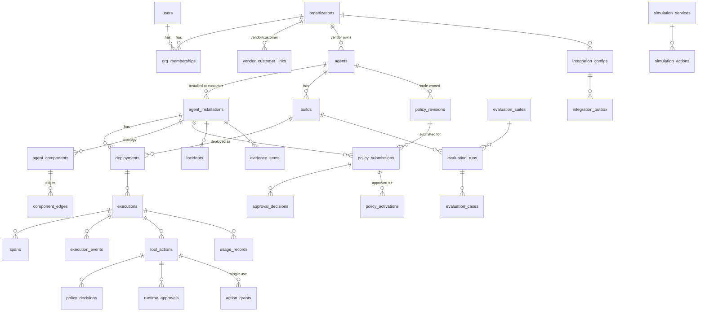

# Schema overview

Migrations: `0001_initial.sql` (from `dev_docs/SCHEMA.sql`), then `0002_grants_and_invariants.sql`. Apply them with `python scripts/init_db.py`, which is idempotent and serialized by an advisory lock.

## Lifecycles

- **Policy:** register (hash) → submission `pending` → `approved` (activation row, supersedes the same key) | `rejected` → `revoked` (activation deactivated). A new hash means a new revision and a new approval.
- **Release:** eval runs per build → `releases/evaluate` creates or updates the deployment as `eligible` | `blocked` → `deploy` (re-checks the gate) → `deployed`, and the previous deployment becomes `retired`.
- **Runtime action:** `tool_actions` row per authorize call → `policy_decisions` (one per cited revision) → `runtime_approvals` `pending → approved → consumed` (or `rejected`/`expired`) → `action_grants` issued → consumed by `SimulationWorld.apply_action` → `/actions/{id}/result`. Timestamps are kept separately: `requested_at`, `authorized_at`, `executed_at`, `verified_at`.
- **Ingestion:** `execution_events.id = event_id` (dedup). Executions and spans may start as placeholders (`status='placeholder'`) and are completed by later events.
